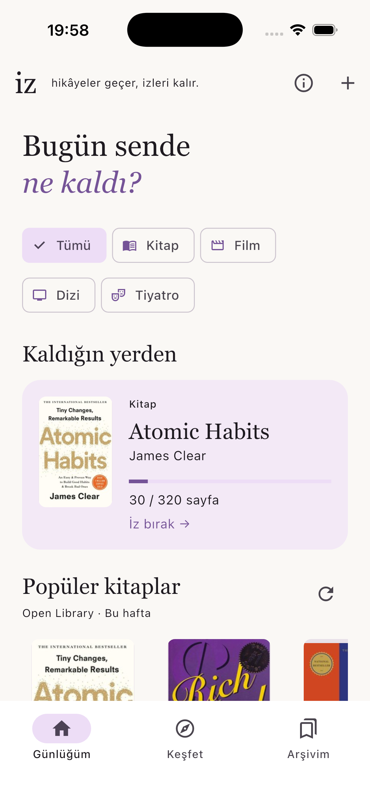
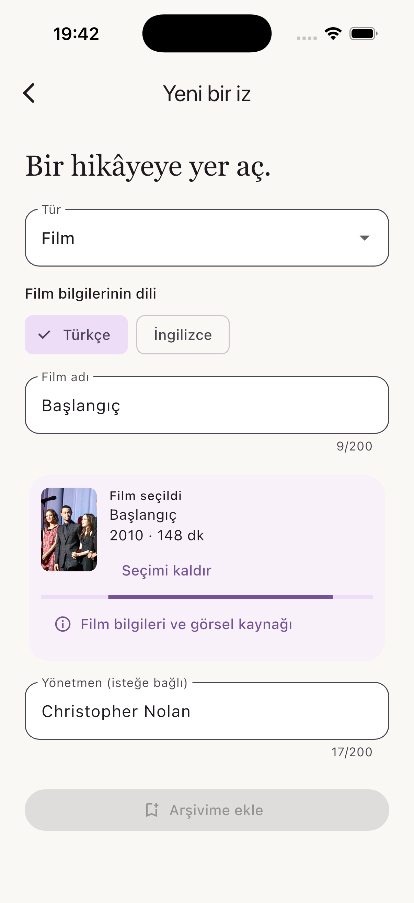

# İZ

<p align="center">
  
</p>

> Hikâyeler geçer, izleri kalır.

İZ; okuduğun kitapları, izlediğin film ve dizileri, gördüğün tiyatro oyunlarını tek bir kişisel kültür günlüğünde biriktiren Flutter uygulamasıdır. Eserleri keşfedebilir, arşivleyebilir; ilerlemeni, puanını, notlarını ve hatırlatıcılarını cihazında saklayabilirsin.

<p align="center">
  
</p>

## Uygulamadan

<table>
  <tr>
    <td align="center"><strong>Günlük ve öneriler</strong></td>
    <td align="center"><strong>Katalogdan eser seçme</strong></td>
  </tr>
  <tr>
    <td width="50%"></td>
    <td width="50%"></td>
  </tr>
</table>

## Neler sunuyor?

- **Kapak odaklı günlük:** Kitap, film, dizi ve tiyatro kayıtlarını görsel bir arşivde toplar.
- **Türkçe ve İngilizce keşif:** Kitap ve katalog aramalarında bilgi dili seçilebilir.
- **Yazarken arama:** Kitap adı iki harfe ulaştığında sonuçlar kısa bir beklemeden sonra otomatik listelenir.
- **Öneri rafları:** Popüler kitaplar ile film, dizi ve tiyatro önerileri yenilenebilir.
- **Ayrıntılı kayıtlar:** Durum, 5 üzerinden puan, kişisel not, sayfa veya bölüm ilerlemesi tutulur.
- **Yerel hatırlatıcılar:** Bir esere cihaz üzerinde çalışan bildirim eklenebilir.
- **İz takvimi:** İlerleme, durum ve not değişiklikleri günlere işlenir.
- **İstatistikler:** Arşiv ve etkinlik geçmişi özetlenir.
- **Çevrimdışı günlük:** Kişisel kayıtlar cihazda saklanır; hesap ve bulut eşitleme yoktur.
- **Erişilebilir arayüz:** Dar ekran, büyük yazı, açık ve koyu tema desteklenir.

Arşive yalnızca eser eklemek takvimi renklendirmez. İlerleme, durum veya not/puan değişikliği o gün için bir iz oluşturur. Aynı eser ve işlem türü aynı gün yeniden güncellendiğinde tek iz olarak kalır.

## Veri kaynakları

| İçerik | Kaynak |
| --- | --- |
| Kitap arama, baskı ve kapak | [Open Library](https://openlibrary.org) |
| Film ve dizi bilgileri | İZ Katalog API; Wikidata, Wikimedia Commons ve TVmaze |
| Tiyatro bilgileri | İZ Katalog API; Wikidata, Wikimedia Commons ve Biletsa |

Kişisel günlük, not, puan ve ilerleme bilgileri katalog servislerine gönderilmez. Çevrimiçi servisler yalnızca arama ve herkese açık eser bilgileri için kullanılır.

## Projeyi çalıştırma

Gereksinimler:

- Flutter `3.41.2` veya uyumlu güncel stable sürüm
- Dart `3.11` veya üzeri
- Android Studio ya da Xcode

```sh
flutter pub get
flutter run
```

Bu kullanımda kitap özellikleri ve bütün türlerde elle kayıt çalışır. Film, dizi ve tiyatro için çevrimiçi katalog aramasını açmak üzere aşağıdaki yapılandırmayı kullan.

## İZ Katalog API

API; Cloudflare Workers ve D1 üzerinde çalışan, Türkçe ve İngilizce kitap, film, dizi ve tiyatro kataloğudur. Kurulum ve veri aktarma adımları [API rehberinde](api/README.md) bulunur.

1. Örnek ayarı yerel dosyaya kopyala:

   ```sh
   cp config/release.example.json config/release.local.json
   ```

2. `IZ_MOVIE_API_URL` alanına yayımlanan Worker adresini yaz.
3. Uygulamayı ayarla başlat:

   ```sh
   flutter run --dart-define-from-file=config/release.local.json
   ```

Derleme ayarı değiştiğinde uygulamayı tamamen durdurup yeniden başlatmak gerekir; hot reload yeterli değildir. `config/release.local.json` yereldir ve Git'e eklenmez.

API'yi yerelde geliştirmek için:

```sh
cd api
npm install
npm test
npm run dev
```

## Test ve kalite kontrolleri

```sh
flutter test
flutter analyze
```

Test paketi; arama ve canlı önerileri, dil değiştirmeyi, sayfalamayı, katalog ayrıntılarını, arşive eklemeyi, kalıcı yerel kayıtları, hata durumlarını, hatırlatıcı akışını, dar ekranı ve büyük yazı kullanımını kapsar.

API testleri:

```sh
cd api
npm test
```

## Proje yapısı

```text
lib/                  Flutter uygulaması
test/                 Birim ve arayüz testleri
api/                  Cloudflare Workers katalog API'si
assets/legal/         Uygulama içi gizlilik metni
config/               Derleme ayarı örnekleri
store/google-play/    Mağaza metinleri, görseller ve yayın rehberi
tool/                 Yayın ve görsel üretim araçları
```

## Gizlilik

İZ hesap oluşturmaz ve kişisel günlüğü kendi sunucusuna yüklemez. Arşiv, notlar, puanlar, ilerleme ve hatırlatıcılar cihazda tutulur. Kullanıcı bütün kayıtlarını uygulamadaki **Yardım ve gizlilik** ekranından silebilir.

Güncel politika: [İZ Gizlilik Politikası](https://iz-catalog-api.iz-katalog.workers.dev/privacy)

## Google Play hazırlığı

Mağaza açıklamaları, Veri güvenliği notları, simge, tanıtım görseli ve imzalı paket adımları [Google Play yayın rehberinde](store/google-play/README.md) bulunur.

Yayın öncesi eksikleri kontrol etmek için:

```sh
python3 tool/build_play_release.py --check
```

İmzalı Android App Bundle oluşturmak için yükleme anahtarı bilgileri `android/key.properties` dosyasında bulunmalıdır:

```sh
python3 tool/build_play_release.py
```

Bu komutlar mağazaya otomatik yükleme veya yayınlama yapmaz. Anahtar dosyaları, parolalar ve yerel yapılandırmalar depoya eklenmemelidir.

## Durum

- Android paket kimliği: `com.ebranurozbalik.iz`
- Uygulama sürümü: `1.0.0+1`
- Android desteği: API 24 ve üzeri
- Google Play için kalan ana teknik adım: Android yükleme anahtarının hazırlanması
